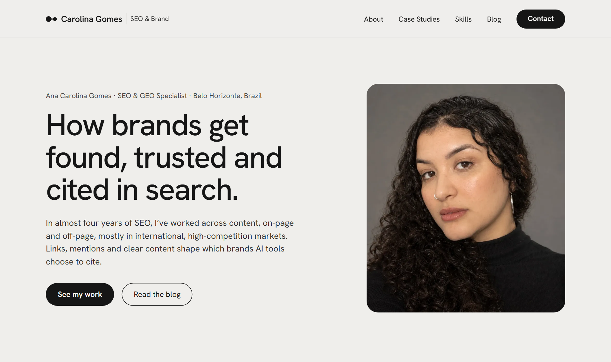

<div align="center">

# Ana Carolina Gomes

**SEO & GEO Specialist** · Belo Horizonte, Brazil

Source code of my portfolio: case studies, skills and articles on SEO, Digital PR and AI search.

[**Visit the site**](https://carolinagomes-seo.github.io) · [Case studies](https://carolinagomes-seo.github.io/case-studies/) · [Blog](https://carolinagomes-seo.github.io/blog/) · [LinkedIn](https://www.linkedin.com/in/anacpsg)

[](https://github.com/carolinagomes-seo/carolinagomes-seo.github.io/actions/workflows/deploy.yml)
[](https://astro.build)

<a href="https://carolinagomes-seo.github.io"></a>

</div>

## About

I work across content, on-page and off-page SEO, with a focus on link building and Digital PR. This site is also a working example of that practice: its technical SEO and AI search setup are built into the code.

## SEO and GEO built in

- **Metadata:** canonical URLs, Open Graph and Twitter card tags on every page
- **Structured data:** one JSON-LD graph per page, linked by `@id` (`Person`, `ProfilePage`, `BlogPosting`, `FAQPage`, `Article`, `BreadcrumbList` and more)
- **Discovery:** XML sitemap, RSS feed and a `robots.txt` that welcomes AI search crawlers
- **AI search:** auto-generated [`/llms.txt`](https://carolinagomes-seo.github.io/llms.txt) summarizing the site for AI assistants
- **Authorship:** bylines, author box, word count and reading time on every post, from one author file

## Built with

- [Astro](https://astro.build): static site, no client-side framework
- Markdown content collections for case studies and blog posts
- Self-hosted Hanken Grotesk font through Astro's font API
- GitHub Actions and GitHub Pages: every push to `main` deploys the site

## Run it locally

Requires Node 22.12 or newer.

```bash
npm install
npm run dev
```

| Command           | Action                                     |
| :---------------- | :----------------------------------------- |
| `npm install`     | Install dependencies (Node 22.12 or newer) |
| `npm run dev`     | Start the dev server at `localhost:4321`   |
| `npm run build`   | Build the site to `./dist/`                |
| `npm run preview` | Preview the build locally                  |

To add a post or a case study, see the [content guide](docs/content-guide.md).

<details>
<summary><strong>Project structure</strong></summary>

```text
public/                    CV, favicons, default social image, robots.txt
src/
├── assets/                Images processed by Astro (portrait, post covers)
├── components/
│   ├── BaseHead.astro     <head>: meta tags, social cards, font, JSON-LD
│   ├── SchemaGraph.astro  The page's JSON-LD graph
│   ├── Header.astro       Sticky header (+ MobileNav.astro, the floating menu on phones)
│   ├── Footer.astro
│   └── Collapsible.astro  Native <details> section used on phones (About, Skills)
├── content/
│   ├── blog/              Blog posts (Markdown)
│   └── case-studies/      Case studies (Markdown)
├── data/
│   ├── author.ts          Name, bio, links, experience, education, languages
│   └── skills.ts          Skill areas, "currently learning" and certifications
├── layouts/BlogPost.astro
├── pages/                 One file per route, plus 404, rss.xml and llms.txt
├── styles/global.css      Design tokens, base type, buttons and shared page styles
├── utils/                 Dates, reading time, posts, case studies, FAQ, schema helpers
├── consts.ts              Site title, description and navigation
└── content.config.ts      Frontmatter schemas
```

</details>

## Contact

[LinkedIn](https://www.linkedin.com/in/anacpsg) · [contato.carolpss@gmail.com](mailto:contato.carolpss@gmail.com)

## Credits

Based on Astro's blog starter, itself based on [Bear Blog](https://github.com/HermanMartinus/bearblog/).

Text, images and CV © Ana Carolina Gomes. All rights reserved.
